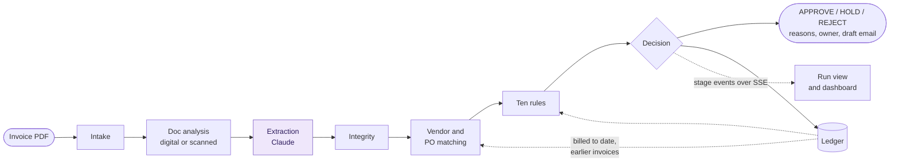
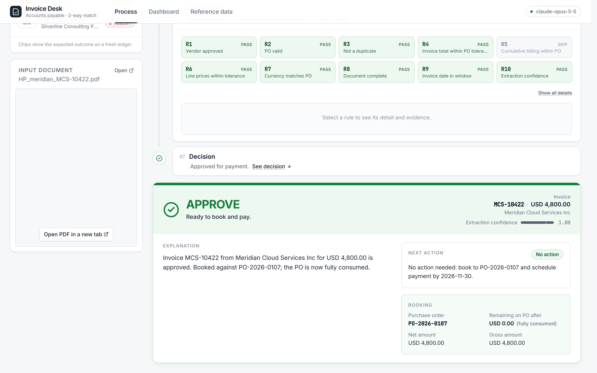
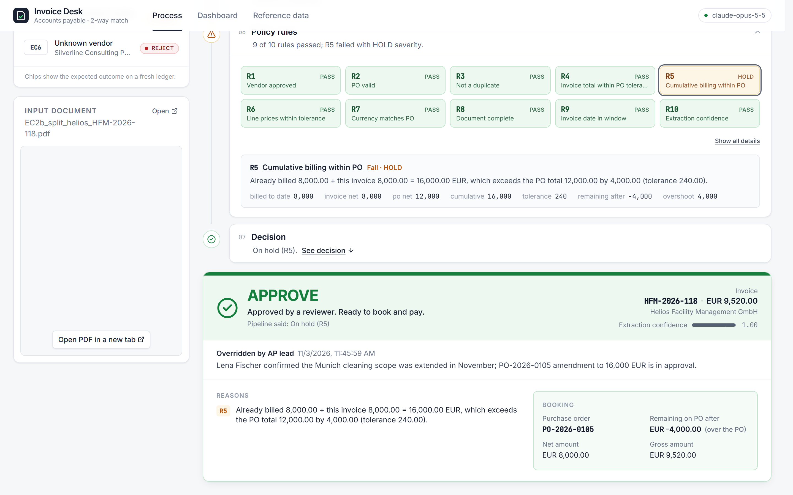
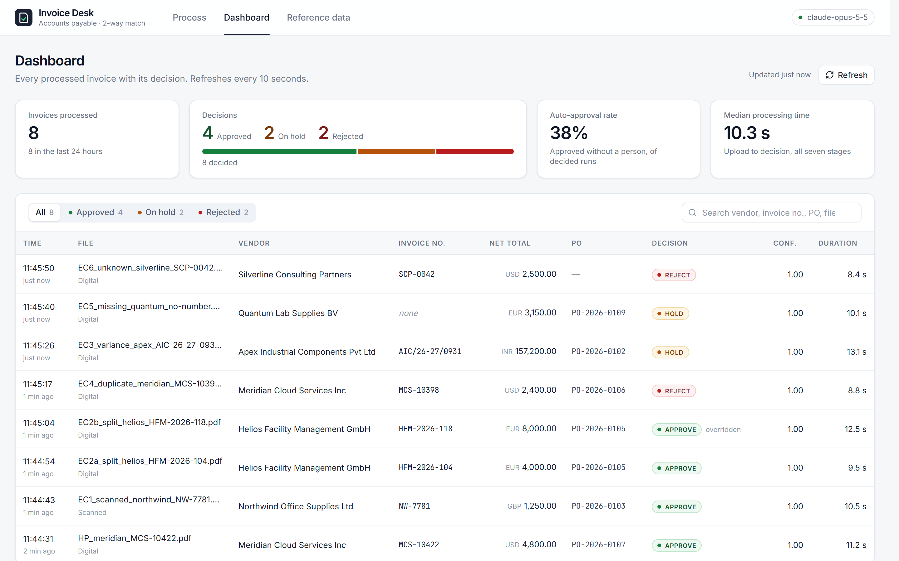

# Invoice processing pipeline

This demo takes a vendor invoice PDF and produces a reasoned APPROVE, HOLD or REJECT decision. It reads the invoice, matches it to vendor, purchase order and ledger records, and shows each of its seven stages live. Every run is kept, so a dashboard shows what was decided and why.

**Design principle:** Claude extracts fields with evidence and confidence; ten deterministic rules decide. Every decision shows its reasons, evidence, next action and owner.



Claude is called once, at extraction. Everything after it is deterministic code, and the ledger feeds back into matching and the rules so each invoice sees the ones before it. The process map with every decision point, the rules in plain words and the path each sample takes is in [docs/PROCESS-MAP.md](docs/PROCESS-MAP.md). The full contract is in [docs/SPEC.md](docs/SPEC.md).

## What it looks like


*Happy path: ten rule chips, then the decision with its explanation, next action and booking against the PO.*


*Split PO, part 2: R5 holds it because the PO is already 8,000 billed; a reviewer approves it anyway, and the pipeline's own HOLD stays on record.*


*Dashboard after the eight samples: decision split, auto-approval rate, and every run with its final decision.*

## Live demo

**URL:** https://app-production-1e54.up.railway.app

1. Pick a sample on the home page, or drop in your own PDF.
2. Watch the stages run: intake, doc analysis, extraction, integrity, matching, rules, decision. Expand any stage to see its output.
3. Open **Dashboard** for totals, past runs and open PO balances.
4. Open **Reference** for purchase orders, the ledger and vendors.
5. Use **Reset demo data** on the Reference page before starting again.

Samples share one ledger, so order matters: EC2b only holds after EC2a has billed the PO, and running a sample twice without a reset is rejected as a duplicate. That rejection is correct behaviour.

## Run locally

### Docker Compose (one command)

Copy `.env.example` to `backend/.env` and set `ANTHROPIC_API_KEY`, then run:

```bash
docker compose up --build
```

The app is at http://localhost:8000. To use another port, set `HOST_PORT`, for example `HOST_PORT=8080 docker compose up --build`. Runs persist in the `app-data` volume; `docker compose down -v` clears them.

### Python with a prebuilt frontend

Follow [backend/README.md](backend/README.md) for the virtual environment and key, and run `npm run build` as described in [frontend/README.md](frontend/README.md). The backend then serves the UI on port 8000.

### Frontend dev server

Start the backend, or the mock API with `npm run mock`, then run `npm run dev` in `frontend/`. Vite serves http://localhost:5173 and proxies `/api` to port 8000. See [frontend/README.md](frontend/README.md).

## Deploy to Railway

The volume keeps the database across deploys. On a fresh volume the database seeds itself on first boot, so there is no manual step.

New Railway services no longer read `railway.json`. It is kept in the repo as a record of the intended settings, so make the settings below by hand. Railway picks up the root `Dockerfile` by itself.

### From GitHub (preferred)

1. Push this repo to GitHub (private is fine; Railway's GitHub app needs access to it).
2. In Railway, choose **New Project → Deploy from GitHub repo** and select the repository.
3. Right-click the project canvas, choose **Volume**, connect it to the service, and set the mount path to `/data`.
4. In the service's **Variables** tab, add `ANTHROPIC_API_KEY`, and add `PORT=8000` so the app listens on the port the domain routes to (Railway otherwise injects its own `PORT`). `EXTRACTION_MODEL` is optional.
5. In **Settings**, set the healthcheck path to `/health`. The default restart policy, On Failure, is fine.
6. In **Settings → Networking**, choose **Generate Domain**, then open `<domain>/health`.

### From the CLI

```bash
npm i -g @railway/cli
```

```bash
railway login
```

```bash
railway init
```

```bash
railway up --detach
```

Then do steps 3 to 6 above in the dashboard. Nothing is committed for this route: `railway up` uploads the working folder and builds the same `Dockerfile`.

Keep one replica, because Railway volumes do not support replicas. The app also needs a single process, since live run events are held in memory.

### Before a demo

The extraction cache lives in the database, so a new volume starts with an empty cache and has no fallback if the API call fails. Run all eight samples once on the live site to fill it, then use **Reset demo data**.

### Container user

The container starts as root only to take ownership of `/data`, because Railway mounts volumes as root. It then drops to the unprivileged `app` user, so `RAILWAY_RUN_UID` is not needed.

## Repo layout

```
backend/app/        FastAPI app: pipeline stages, extraction, matching, rules, API
backend/tests/      Unit, API and full-sample tests
backend/tools/      Extraction recording and cache warming
frontend/           Vite, React and TypeScript UI, plus a mock API
data/               Reference CSVs, samples.json and the eight sample PDFs
scripts/            Fixture generator and README screenshot capture
docs/               Process map, SPEC.md and screenshots
deploy/             Container entrypoint
config.yaml         Policy tolerances and extraction settings
Dockerfile          Multi-stage build; docker-compose.yml and railway.json sit beside it
```

## The eight samples

Listed in demo order. Run them in this order after a reset.

| ID | Sample | Expected decision | Rules that fail |
|---|---|---|---|
| HP | Happy path — Meridian Cloud, PO matches exactly | APPROVE | none |
| EC1 | Scanned invoice — Northwind, image-only PDF | APPROVE | none |
| EC2a | Split PO, part 1 — Helios, within remaining balance | APPROVE | none |
| EC2b | Split PO, part 2 — Helios, exceeds remaining balance | HOLD | R5 |
| EC4 | Duplicate — Meridian MCS-10398 re-sent in a new layout | REJECT | R3, R5 |
| EC3 | Price variance — Apex flange 8% above PO | HOLD | R4, R6 |
| EC5 | Missing invoice number and PO — Quantum Lab | HOLD | R8 |
| EC6 | Unknown vendor — Silverline Consulting Partners | REJECT | R1, R2 |

## Assumptions and non-goals

Assumptions:

1. 2-way match only; no goods receipt / 3-way match.
2. One currency per PO; invoice currency must match.
3. Tolerance policy: max(2 %, 25 units) on totals and on unit prices. Configurable in `config.yaml`.
4. A vendor may split a PO across invoices; cumulative billing is tracked in the ledger.
5. Duplicate = same vendor + invoice number, or identical file, or same vendor + total + date within 3 days.
6. HOLD means a human decides; the process never silently drops an invoice.
7. Extraction confidence below 0.75 on invoice no, total, or vendor forces human review regardless of rules.
8. The LLM never makes the decision; it extracts. Rules decide. This is deliberate for auditability.

Non-goals for v1, from [docs/SPEC.md](docs/SPEC.md) §10: LLM-written analyst note, 3-way match / goods receipts, multi-invoice batch upload, authentication, email sending (drafts only), multi-currency conversion.
