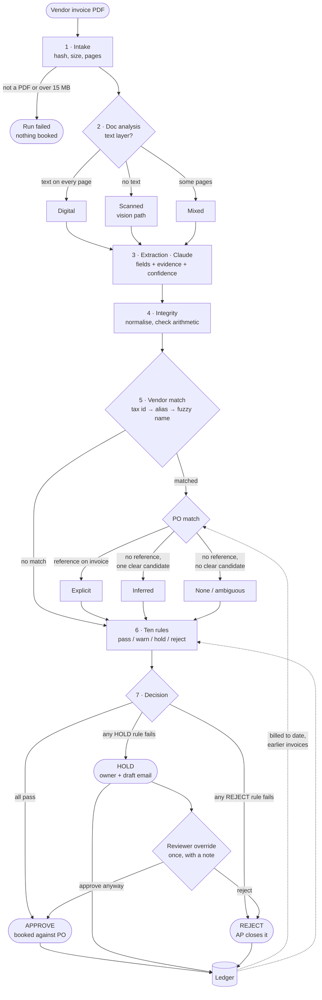

# Process map

This is the accounts-payable process drawn before any code was written: what happens to an invoice from the moment it arrives to the moment someone acts on the decision. The exact contract for each stage is in [SPEC.md](SPEC.md) §4; this page is the map.

The rule throughout: **Claude reads the invoice, code decides.** Only stage 3 calls a model. Every other stage is deterministic, so the same invoice against the same ledger always gets the same decision, and each decision can be traced to a named rule.

## The flow

The dotted lines matter. The ledger feeds back into matching and the rules, so the second invoice on a purchase order sees what the first one billed, and a re-sent invoice meets its original.

## The stages

### 1 · Intake
- **Input:** the PDF, uploaded or picked from the samples.
- **What happens:** the file is hashed (SHA-256), sized and page-counted, and a run is opened.
- **Output:** run id, file hash, size, page count.
- **What can go wrong:** not a PDF, or over 15 MB. The run fails here and nothing reaches the ledger.

### 2 · Document analysis
- **Input:** the PDF.
- **What happens:** each page's text layer is measured. Fewer than 50 characters means the page is treated as scanned.
- **Output:** `digital`, `scanned` or `mixed`, characters per page, and the text dump when there is one.
- **What can go wrong:** a scan with a junk text layer could pass as digital. The extraction step sees the page image either way, so the class changes the path label and the warning, not the reading.

### 3 · Extraction (the only model call)
- **Input:** the PDF as a native document, plus the text dump if there is one.
- **What happens:** Claude returns a fixed schema: header fields, totals, line items and PO references. Each field carries a value, a confidence from 0 to 1, and the quote and page it came from.
- **Output:** the structured extraction, with token usage and latency.
- **What can go wrong:** the API fails (a cached extraction is used when one exists), or a field is misread. Misreads are caught downstream by the arithmetic checks and by the confidence rule, not trusted.

### 4 · Integrity
- **Input:** the extraction.
- **What happens:** amounts, dates, currencies, tax ids and PO references are normalised. Lines are summed against the subtotal, and subtotal plus tax against the total. Required fields are checked.
- **Output:** the normalised invoice, a list of checks with pass or fail, and the lowest confidence on the critical fields (invoice number, total, vendor).
- **What can go wrong:** totals that do not add up, missing fields, unparseable dates. This stage only records them; the rules decide what they mean.

### 5 · Vendor and PO matching
- **Input:** the normalised invoice, the vendor master, open purchase orders and the ledger.
- **What happens:** the vendor is matched by tax id, then by known alias, then by fuzzy name (90 or better). The PO is matched by the reference on the invoice; if there is none, it is inferred from that vendor's open POs by amount and line similarity, and accepted only if one candidate is clearly ahead.
- **Output:** the matched vendor and PO with method and score, the amount already billed on the PO, the remaining balance, and line-by-line matches.
- **What can go wrong:** unknown vendor, a PO number that does not exist, a PO belonging to a different vendor, or two equally plausible POs. Each is reported as such; none is guessed.

### 6 · Rules
- **Input:** everything above, plus the ledger.
- **What happens:** ten rules run as pure functions. Each returns pass, warn, or fail with a severity, and the numbers behind it. Rules that need a PO are skipped (grey) when there is none.
- **Output:** ten results with detail and evidence.
- **What can go wrong:** nothing silently. A rule either passes, fails with its reason, or says it was not evaluated and why.

### 7 · Decision
- **Input:** the rule results.
- **What happens:** any REJECT failure gives REJECT; otherwise any HOLD failure gives HOLD; otherwise APPROVE. The explanation is templated from the failing rules, not written by a model. The next action goes to one owner, and a draft email is written when that owner is the vendor or the requester.
- **Output:** decision, reasons, explanation, owner and next action, draft email, and on approval the booking against the PO with its remaining balance. A ledger row is written.
- **What can go wrong:** the decision is only as good as the reference data; it never fails on its own.

### After the decision · Reviewer override
A HOLD is a question for a person, so a reviewer can answer it once: approve anyway or reject, with a note and their name. The pipeline's own decision is kept beside the override, never rewritten. An approval updates the ledger row, so later invoices on the same PO see the amount as billed.

## The ten rules

| Code | Question it answers | Fails to | Who acts next |
|---|---|---|---|
| R1 | Is this a vendor we know and have approved? | REJECT if unknown, HOLD if suspended | AP |
| R2 | Is there an open PO from this vendor to bill against? | REJECT if the PO does not exist or is closed; HOLD if no PO, two candidates, or the PO belongs to another vendor | Requester (AP if rejected) |
| R3 | Have we already seen this invoice? Same vendor and number, same file, or same vendor, amount and date within 3 days | REJECT | AP |
| R4 | Is the invoice total within tolerance of the PO? Tolerance is the larger of 2% and a per-currency floor | HOLD | Requester |
| R5 | With everything already billed on this PO, is there still room for this invoice? | HOLD | Requester |
| R6 | Does each line's unit price match the PO line within 2%? | HOLD | Requester |
| R7 | Is the invoice in the PO's currency? | HOLD | Requester |
| R8 | Does the invoice have a number, date, total and vendor, and does its arithmetic add up? | HOLD, with a draft email to the vendor | Vendor |
| R9 | Is the invoice date within the last 90 days and not in the future? | HOLD | AP |
| R10 | Was the model confident (0.75 or better) on invoice number, total and vendor? | HOLD for a person to check the reading | AP |

When several rules fail, one owner is chosen: any rejection goes to AP; otherwise the vendor (the invoice cannot be booked without the missing fields); otherwise the requester; otherwise AP. Warnings, such as "PO inferred, confirm with requester", never change the decision; they appear in the explanation.

## The eight samples

Run in this order after a reset; the ledger carries over between them.

| Order | Sample | Path it exercises | Decision |
|---|---|---|---|
| 1 | HP · Meridian, clean digital invoice | Digital → explicit PO → all ten rules pass → booked | APPROVE |
| 2 | EC1 · Northwind, image-only scan | Scanned → vision extraction → same outcome as digital | APPROVE |
| 3 | EC2a · Helios, split PO part 1 | PO number only inside a sentence, German number format; R5 not evaluated as nothing billed yet; leaves 4,000 open | APPROVE |
| 4 | EC2b · Helios, split PO part 2 | Ledger feedback: 8,000 billed + 8,000 > 12,000 PO, so R5 holds it; then a reviewer override to APPROVE | HOLD → APPROVE |
| 5 | EC4 · Meridian invoice re-sent in a new layout | Different file hash, same vendor and number → R3; the original already used the PO → R5 | REJECT |
| 6 | EC3 · Apex flange 8% over PO price | Indian GST layout; R4 and R6 quote the line, both prices and the tolerance; email to the requester | HOLD |
| 7 | EC5 · Quantum Lab, no invoice number, no PO | PO inferred from vendor, amount and lines; R8 holds it and drafts an email to the vendor | HOLD |
| 8 | EC6 · Silverline, unknown vendor | No vendor match → R1; PO in the description does not exist → R2 | REJECT |
